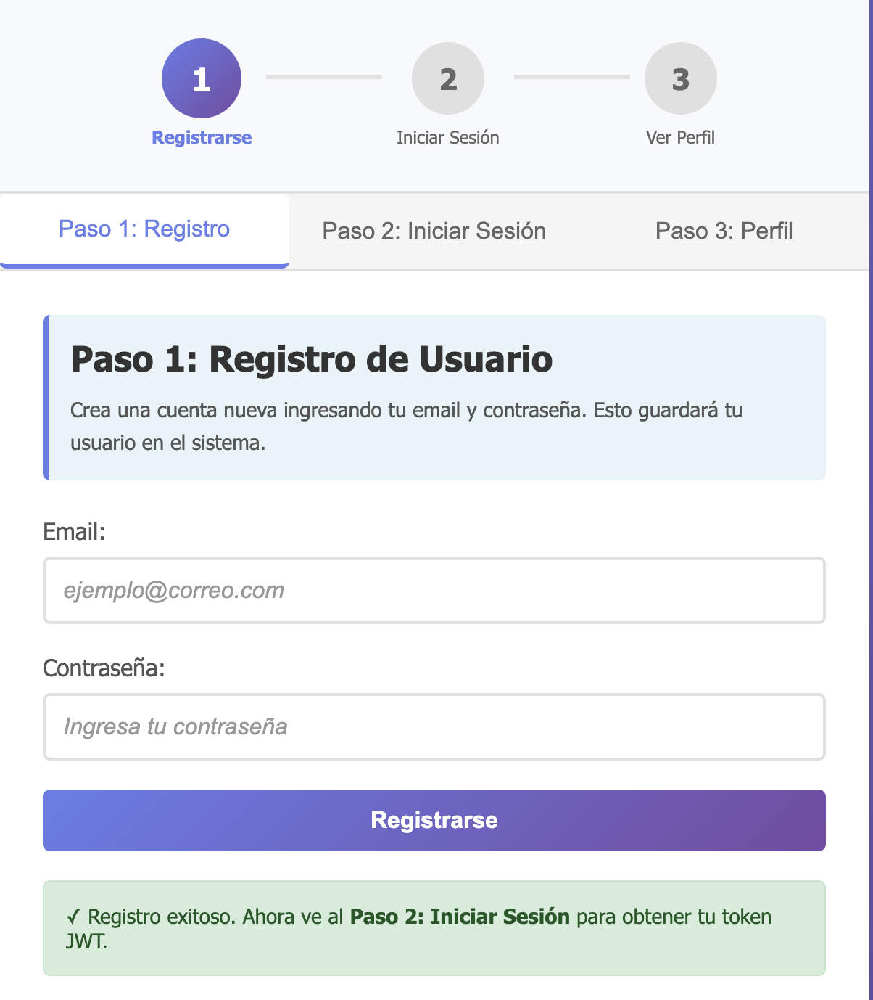
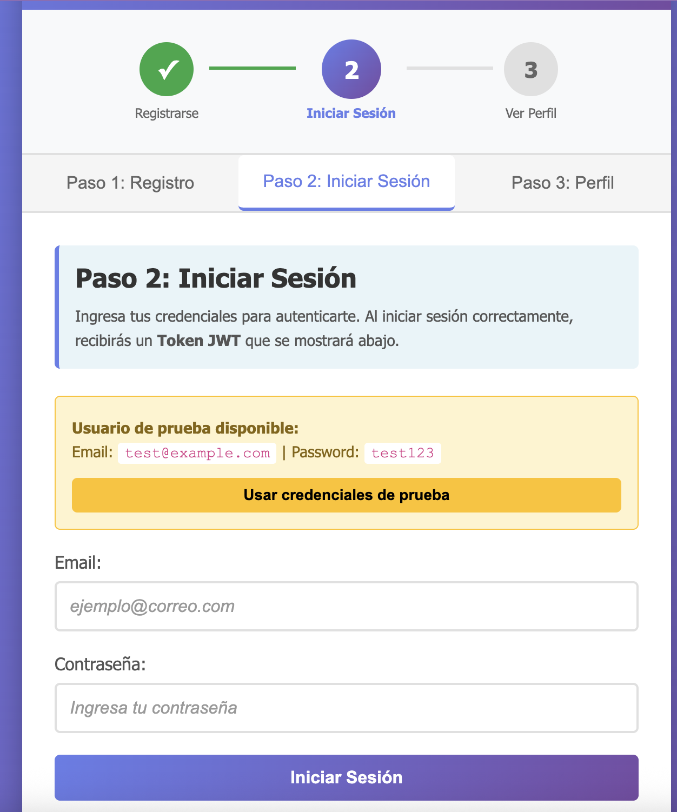
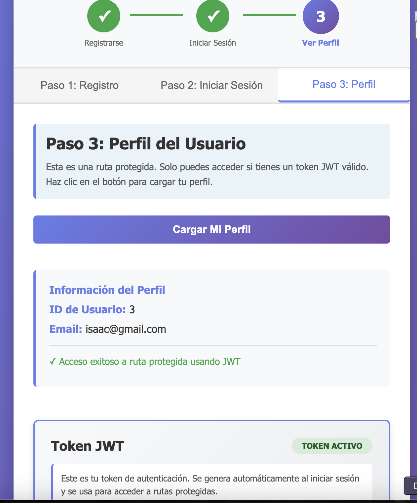

  

# Sistema de Autenticación con JWT

Este proyecto implementa un sistema de autenticación utilizando JSON Web Tokens (JWT) en una aplicación Node.js con Express. Incluye un frontend simple para demostrar el funcionamiento del sistema.

## Autor

**Magdalena Inalaf**

- GitHub: https://github.com/MagdaIG
- LinkedIn: https://www.linkedin.com/in/minalaf/
- Página web: https://inalaf.ca/
- Email: magda.inalaf@gmail.com

## Descripción

Este proyecto demuestra cómo implementar:

- Registro de usuarios
- Inicio de sesión con generación de JWT
- Protección de rutas mediante middleware de autenticación
- Verificación de tokens JWT
- Manejo de errores en autenticación

## Requisitos Previos

- Node.js (versión 14 o superior)
- npm (incluido con Node.js)

## Instalación

1. Clona o descarga este repositorio

2. Abre una terminal en el directorio del proyecto

3. Instala las dependencias necesarias:

```bash
npm install
```

Esto instalará las siguientes dependencias:
- express: Framework web para Node.js
- jsonwebtoken: Librería para crear y verificar JWT
- body-parser: Middleware para parsear el cuerpo de las peticiones HTTP

## Configuración

El servidor está configurado para ejecutarse en el puerto 3000 por defecto. Puedes cambiar el puerto modificando la variable `PORT` en el archivo `server.js`.

La clave secreta para firmar los tokens JWT está definida en la variable `SECRET_KEY` en `server.js`. En un entorno de producción, deberías usar una variable de entorno para almacenar esta clave de forma segura.

## Ejecución

Para iniciar el servidor, ejecuta:

```bash
npm start
```

O alternativamente:

```bash
node server.js
```

Deberías ver un mensaje en la consola indicando que el servidor está corriendo:

```
Servidor corriendo en http://localhost:3000
Frontend disponible en http://localhost:3000
```

## Uso

### Acceso al Frontend

Una vez que el servidor esté corriendo, abre tu navegador web y visita:

```
http://localhost:3000
```

Verás una interfaz intuitiva con un indicador de progreso y tres pestañas que te guían paso a paso a través del proceso de autenticación JWT.

### Guía Visual de Uso

La aplicación está diseñada con una interfaz clara que muestra el progreso en cada paso. A continuación se explica cada paso con capturas de pantalla:

#### Paso 1: Registro de Usuario



En esta primera pantalla puedes crear una nueva cuenta de usuario:

1. **Indicador de Progreso**: En la parte superior verás un indicador visual que muestra tres pasos. El Paso 1 está resaltado en color púrpura/azul, indicando que es el paso actual.

2. **Instrucciones**: La sección incluye instrucciones claras que explican: "Crea una cuenta nueva ingresando tu email y contraseña. Esto guardará tu usuario en el sistema."

3. **Formulario de Registro**:
   - **Email**: Ingresa un email válido (ejemplo: `usuario@ejemplo.com`)
   - **Contraseña**: Ingresa una contraseña
   - Haz clic en el botón "Registrarse" con el gradiente púrpura/azul

4. **Confirmación**: Si el registro es exitoso, verás un mensaje verde con un checkmark que dice: "✓ Registro exitoso. Ahora ve al **Paso 2: Iniciar Sesión** para obtener tu token JWT."

El indicador de progreso mostrará el Paso 1 como completado (con un checkmark verde) cuando el registro sea exitoso.

#### Paso 2: Iniciar Sesión



Esta es la pantalla donde obtendrás tu token JWT:

1. **Indicador de Progreso**: El Paso 1 aparece marcado como completado (checkmark verde), y el Paso 2 está activo (círculo púrpura con el número 2).

2. **Credenciales de Prueba**: En un recuadro amarillo destacado, encontrarás:
   - **Email de prueba**: `test@example.com`
   - **Password de prueba**: `test123`
   - Un botón amarillo "Usar credenciales de prueba" que llena automáticamente los campos

3. **Formulario de Login**:
   - Ingresa el email y contraseña (puedes usar las credenciales de prueba o las que registraste)
   - Haz clic en "Iniciar Sesión"

4. **Token JWT**: Al iniciar sesión exitosamente:
   - Verás un mensaje de éxito indicando que tu token JWT aparece abajo
   - En la sección inferior "Token JWT" verás:
     - Estado: "TOKEN ACTIVO" (badge verde)
     - El token completo (una cadena larga que comienza con `eyJ...`)
     - Botones para "Copiar Token" y "Limpiar Token"
   - El token se guarda automáticamente en el navegador

5. **Siguiente Paso**: Aparecerá un mensaje verde indicando que puedes ir al Paso 3 para ver tu perfil.

#### Paso 3: Perfil del Usuario (Ruta Protegida)



Esta pantalla demuestra el acceso a una ruta protegida usando JWT:

1. **Indicador de Progreso**: Los Pasos 1 y 2 aparecen completados (checkmarks verdes), y el Paso 3 está activo (círculo azul con el número 3).

2. **Instrucciones**: La sección explica: "Esta es una ruta protegida. Solo puedes acceder si tienes un token JWT válido. Haz clic en el botón para cargar tu perfil."

3. **Cargar Perfil**: Haz clic en el botón "Cargar Mi Perfil" con gradiente púrpura/azul.

4. **Información del Perfil**: Si el token es válido, verás:
   - **ID de Usuario**: El ID asignado al registrarte
   - **Email**: Tu dirección de email
   - Un mensaje de confirmación: "✓ Acceso exitoso a ruta protegida usando JWT"

5. **Token JWT**: En la parte inferior, la sección del token muestra:
   - Estado "TOKEN ACTIVO" (badge verde)
   - Explicación del token: "Este es tu token de autenticación. Se genera automáticamente al iniciar sesión y se usa para acceder a rutas protegidas."
   - El token completo visible
   - Opciones para copiar o limpiar el token

Si intentas acceder sin un token válido, verás un mensaje de error indicando que necesitas autenticarte primero.

### Uso con API (cURL o Postman)

#### Registro de Usuario

```bash
curl -X POST http://localhost:3000/register \
  -H "Content-Type: application/json" \
  -d '{"email":"usuario@example.com","password":"miPassword123"}'
```

#### Inicio de Sesión

```bash
curl -X POST http://localhost:3000/login \
  -H "Content-Type: application/json" \
  -d '{"email":"usuario@example.com","password":"miPassword123"}'
```

La respuesta incluirá un token JWT:

```json
{
  "success": true,
  "message": "Inicio de sesión exitoso",
  "token": "eyJhbGciOiJIUzI1NiIsInR5cCI6IkpXVCJ9...",
  "user": {
    "id": 1,
    "email": "usuario@example.com"
  }
}
```

#### Acceder al Perfil (Ruta Protegida)

```bash
curl -X GET http://localhost:3000/profile \
  -H "Authorization: Bearer TU_TOKEN_JWT_AQUI"
```

## Estructura del Proyecto

```
usuario-jwt/
├── server.js          # Servidor Express con rutas y middleware
├── package.json       # Dependencias y configuración del proyecto
├── README.md         # Este archivo
├── images/           # Imágenes de documentación
│   ├── paso1.png    # Captura de pantalla - Paso 1
│   ├── paso2.png    # Captura de pantalla - Paso 2
│   └── paso3.png    # Captura de pantalla - Paso 3
└── public/           # Archivos del frontend
    ├── index.html    # Interfaz de usuario
    ├── styles.css    # Estilos CSS
    └── app.js        # Lógica del frontend
```

## Endpoints de la API

### POST /register
Registra un nuevo usuario.

**Body:**
```json
{
  "email": "usuario@example.com",
  "password": "miPassword123"
}
```

**Respuesta exitosa (201):**
```json
{
  "success": true,
  "message": "Usuario registrado exitosamente",
  "user": {
    "id": 1,
    "email": "usuario@example.com"
  }
}
```

### POST /login
Inicia sesión y genera un token JWT.

**Body:**
```json
{
  "email": "usuario@example.com",
  "password": "miPassword123"
}
```

**Respuesta exitosa (200):**
```json
{
  "success": true,
  "message": "Inicio de sesión exitoso",
  "token": "eyJhbGciOiJIUzI1NiIsInR5cCI6IkpXVCJ9...",
  "user": {
    "id": 1,
    "email": "usuario@example.com"
  }
}
```

### GET /profile
Obtiene el perfil del usuario autenticado. Requiere autenticación JWT.

**Headers:**
```
Authorization: Bearer TU_TOKEN_JWT_AQUI
```

**Respuesta exitosa (200):**
```json
{
  "success": true,
  "message": "Perfil del usuario",
  "user": {
    "id": 1,
    "email": "usuario@example.com"
  }
}
```

## Manejo de Errores

El servidor maneja los siguientes casos de error:

- **400 Bad Request**: Datos incompletos en la solicitud
- **401 Unauthorized**: Contraseña incorrecta o token no proporcionado
- **403 Forbidden**: Token inválido o expirado
- **404 Not Found**: Usuario no encontrado
- **409 Conflict**: Usuario ya existe (en registro)

Todas las respuestas de error incluyen un objeto JSON con los campos `error` y `message`:

```json
{
  "error": "Usuario no encontrado",
  "message": "No existe un usuario con ese email"
}
```

## Características del JWT

- **Algoritmo**: HS256
- **Tiempo de expiración**: 1 hora
- **Payload**: Contiene `userId` y `email` del usuario

## Notas de Seguridad

Este proyecto es una demostración educativa. Para un entorno de producción, considera:

1. Usar variables de entorno para la clave secreta JWT
2. Hashear las contraseñas con bcrypt antes de almacenarlas
3. Implementar rate limiting para prevenir ataques de fuerza bruta
4. Usar HTTPS para todas las comunicaciones
5. Validar y sanitizar todas las entradas del usuario
6. Implementar refresh tokens para mejorar la seguridad
7. Usar una base de datos real en lugar de un array en memoria

## Solución de Problemas

### El servidor no inicia

- Verifica que el puerto 3000 no esté en uso
- Asegúrate de haber instalado todas las dependencias con `npm install`
- Revisa que tengas Node.js instalado correctamente

### Error "Cannot GET /"

- Asegúrate de que el servidor esté corriendo
- Verifica que estés accediendo a `http://localhost:3000`
- Revisa que la carpeta `public` exista y contenga `index.html`

### El token no funciona

- Verifica que el token no haya expirado (expira después de 1 hora)
- Asegúrate de incluir el token en el header `Authorization` con el formato `Bearer TOKEN`
- Verifica que estés usando el mismo servidor que generó el token

## Licencia

ISC

